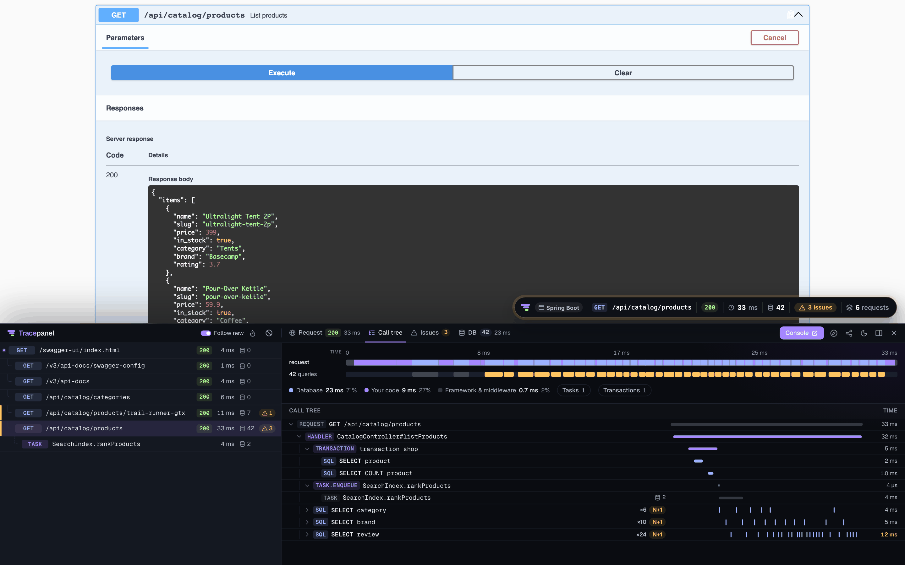
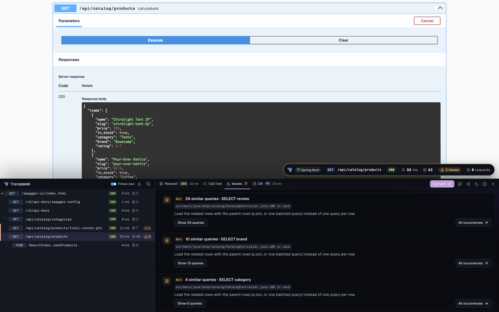

# Tracepanel for Java

[](https://github.com/tracepanel/tracepanel-java/actions/workflows/ci.yml)
[](https://central.sonatype.com/namespace/dev.tracepanel)
[](https://github.com/tracepanel/tracepanel-java#tracepanel-for-java)

**See what your Spring Boot or Ktor app is really doing.** Tracepanel records
each request, `@Async` task, scheduled job and message of your app, in Java or
Kotlin, with its SQL queries, Redis and MongoDB commands, outgoing HTTP calls,
logs and errors. It points out N+1 queries, duplicates, slow SQL and long
transactions, and names the line of code to fix. You read it in a panel on
your pages and in a console.

It runs while you develop, and everything stays on your machine.

[](https://tracepanel.dev/video/demo-java.mp4)

▶ [Watch the 40-second demo](https://tracepanel.dev/video/demo-java.mp4)

## Works with

| | Supported |
| --- | --- |
| **Java** | 17 and later, apps in Java or Kotlin. |
| **Frameworks** | Spring Boot 3.5 and 4 with Spring MVC, Kotlin suspend functions, `Callable` and `DeferredResult` handlers included. Ktor 3. WebFlux apps aren't supported yet. |
| **Databases** | SQL through JDBC, whatever runs it: Spring Data JPA, Hibernate, `JdbcTemplate`, jOOQ, Exposed. Transactions. EXPLAIN on PostgreSQL, MySQL, H2 and SQLite. |
| **Redis and MongoDB** | Lettuce (Spring Data Redis, the cache) and Spring Data MongoDB, with their own N+1 and duplicates. |
| **Messaging** | Kafka and RabbitMQ: what a `KafkaTemplate` or a `RabbitTemplate` sends, and each message a `@KafkaListener` or `@RabbitListener` receives as a trace of its own, linked to the one that sent it. |
| **HTTP clients** | `RestClient`, `RestTemplate`, `WebClient` and the JDK's `HttpClient`, each call with a `traceparent`. Ktor's client through `TracepanelClient`. |
| **Background work** | `@Async` methods as tasks, linked to the request that queued them; `@Scheduled` methods, `CommandLineRunner`s and `ApplicationRunner`s as jobs; the tasks in flight listed live. |
| **Logs** | Logback and Log4j 2, each record on the request or task that made it, with its line, MDC and exception. |
| **Errors** | Thrown in a handler, with your frames and the source around them. |
| **Profiling** | Where a request's time goes in code, as a flame graph, when you ask for it. |
| **Browser** | The badge and its panel on your app's HTML pages and its Swagger UI. |
| **Tests** | JUnit Jupiter 5.12 and later, and JUnit 6, through `tracepanel-junit`: a test that makes an N+1 or duplicate queries fails. See [In tests](#in-tests). |

The settings and what each integration records are in the
[Java docs](https://tracepanel.dev/docs/java).

## Install

Spring Boot: add the dependency for development only, so the production build
leaves it out. With Gradle:

```kotlin
// build.gradle.kts
dependencies {
    developmentOnly("dev.tracepanel:tracepanel-spring-boot:0.9.0")
}
```

With Maven, add it in a profile that only development runs use:

```xml
<profiles>
  <profile>
    <id>dev</id>
    <dependencies>
      <dependency>
        <groupId>dev.tracepanel</groupId>
        <artifactId>tracepanel-spring-boot</artifactId>
        <version>0.9.0</version>
      </dependency>
    </dependencies>
  </profile>
</profiles>
```

Ktor:

```kotlin
// build.gradle.kts
dependencies {
    implementation("dev.tracepanel:tracepanel-ktor:0.9.0")
}
```

The SDK downloads its agent, which keeps the traces and serves the console,
the first time it runs (see [In every app](#in-every-app)).

## Setup

### Spring Boot

Run the app with Spring's `dev` profile, or with DevTools among its
dependencies: `./gradlew bootRun --args='--spring.profiles.active=dev'`, or
`./mvnw spring-boot:run -Pdev -Dspring-boot.run.profiles=dev` (`-Pdev` is
the Maven profile above, the property Spring's). Spring Boot picks
Tracepanel up by its auto-configuration: there is no code to add. Open a
page or the Swagger UI for the badge. The console is at `/__tracepanel__/`
on your app.

Tracepanel turns on in development: with a `dev`, `development` or `local`
profile, or with Spring Boot DevTools on the classpath. Elsewhere it stays
off, even if the dependency reached the build by mistake, and says so once in
the log. `TRACEPANEL_ENABLED=1` turns it on anyway, `TRACEPANEL_ENABLED=0`
off.

### Ktor

Install the plugin. Ktor has no dependency injection to find your DataSource
or your HTTP client by, so you hand them over:

```kotlin
fun Application.module() {
    install(Tracepanel)
    val db = Database.connect(Jdbc.dataSource(hikari, "default"))
    val http = HttpClient(CIO) { install(TracepanelClient) }
}
```

Tracepanel is on in Ktor's development mode (`-Dio.ktor.development=true`,
or `ktor.development` in the config), or with `TRACEPANEL_ENABLED=1`. The
dependency goes into the production build, where it stays off. The console
is at `/__tracepanel__/` on your app.

## What it looks like

Each request shows its call tree, with the SQL queries, the calls and the
issues in it. Here a Spring Boot store on Postgres lists its products from
Swagger UI, and Hibernate loads each product's category and brand, and its
rating, in a query of its own:



The panel lists the requests the page made, here Swagger UI's Execute and the
`@Async` task it queued. Each issue names the line of Java that ran it and the
fix:



## What it records

### Spring Boot

- Each request, named by its route (`GET /owners/{id}`), with its controller
  method.
- SQL through JDBC (Spring Data JPA, Hibernate, `JdbcTemplate`, jOOQ), with
  the line that ran it.
- Transactions, with the statements inside them.
- Logback and Log4j 2 records, with their line, MDC and exception.
- Errors a handler throws, with your frames and the source around them.
- Calls through `RestClient`, `RestTemplate`, `WebClient` and the JDK's
  `HttpClient`.
- Redis commands through Lettuce, and MongoDB commands through Spring Data
  MongoDB.
- Kafka and RabbitMQ messages sent, and each one received as a trace.
- Kotlin suspend, `Callable` and `DeferredResult` handlers, as one trace until
  the answer.
- `@Async` methods as tasks, `@Scheduled` methods and `CommandLineRunner`s as
  jobs.
- The signed-in user from Spring Security, or
  `Tracepanel.setUser(id, username)`.

### Ktor

- Each call, named by its route (`GET /books/{id}`), its coroutines included.
- SQL through `Jdbc.dataSource` (Exposed, plain JDBC), and calls through
  `TracepanelClient`.
- Logs and errors as in Spring Boot, and the user from
  `call.tracepanelUser(id, username)`.

What each integration records, and its limits, are in
[Integrations](https://tracepanel.dev/docs/java/integrations).

## Dumps

`Tracepanel.dump(...)` prints values to look at, as python-devtools'
`debug()` does: the line that called it, then each value as written in the
call, its pretty text, its type and its length, on stderr:

```java
Tracepanel.dump(order, order.lines(), "here");
```

```
src/main/java/shop/Orders.java:42 place
    order: Order[id=7, total=12.50, lines=[Line[sku="pen", quantity=2]]] (Order)
    order.lines(): [Line[sku="pen", quantity=2]] (List) len=1
    "here" (String) len=4
```

In a trace, the dump is also on the request's call tree, which always shows
it. From Kotlin, `import dev.tracepanel.core.Tracepanel.dump` makes it
`dump(order)`. A value under a secret's name, such as `password` or `token`,
is masked. The expressions come from the source under the project's `src/`;
without it, the values print alone.

## In tests

`tracepanel-junit` runs each test as a trace and fails a test that makes
an N+1 or duplicate queries, its own or those of the requests it makes of
the app. Add it to the test dependencies, next to the framework's:

```kotlin
// build.gradle.kts
dependencies {
    testImplementation("dev.tracepanel:tracepanel-junit:0.9.0")
}
```

With Maven, it is a `test` scoped dependency.

Turn it on with `@Tracepanel` on a test class, or on every test class
with JUnit's extension autodetection, which finds it in the jar:

```properties
# src/test/resources/junit-platform.properties
junit.jupiter.extensions.autodetection.enabled=true
```

```java
import static dev.tracepanel.junit.TracepanelExtension.maxQueries;

@Tracepanel
@SpringBootTest
@AutoConfigureMockMvc
class FeedTest {
    @Autowired
    MockMvc mvc;

    @Test
    @Tracepanel(maxQueries = 10, allow = "n+1")
    void feed(TestTrace trace) throws Exception {
        mvc.perform(get("/feed")).andExpect(status().isOk());
        assertThat(trace.queries()).isLessThanOrEqualTo(10);
        maxQueries(2, () -> mvc.perform(get("/feed?page=2")));
    }
}
```

The extension starts the project's agent unless one runs. A request the
test makes of the app, with `MockMvc`, `TestRestTemplate`, `WebTestClient`
or Ktor's `testApplication` client, is linked to the test's trace. Spring
Boot's test slices, such as `@WebMvcTest` and `@DataJpaTest`, are traced
too. Outside Spring, wrap the `DataSource` with
`Jdbc.dataSource(dataSource, "default")`.

When a test passes, the agent looks at its traces. An issue of a kind that
fails tests fails it, with the issue, its query, the line of your code that
made it and a link to the trace:

```
tracepanel found 1 issue in this test:

N+1: 4 similar queries · SELECT author
  SELECT name FROM author WHERE id = ?
  at src/main/java/shop/Books.java:54 in titlesWithAuthors
  Load the related rows with the parent rows (a join, or one batched query) instead of one query per row.

The test's trace: http://127.0.0.1:52817/#/t/01KQ8M0Z9E6X4V2B7N3C5D1F0G
Allowed here with @Tracepanel(allow = "n+1").
```

`n+1` and `duplicates` fail a test by default. The `tracepanel.failOn`
configuration parameter names others, in `junit-platform.properties` or as
a system property: `tracepanel.failOn=n+1, duplicates, slow-sql`.

`@Tracepanel` on a test method or class changes its rules. `failOn` replaces
the kinds, `allow` takes kinds out, and `maxQueries` caps the queries. The
method's rules come first, then its class's.

`TestTrace`, as a parameter or from `TracepanelExtension.testTrace()`, has
the queries so far (`queries()`, `sql()`), `issues()` and the trace's
`url()`. `maxQueries(n, () -> ...)` fails when the block makes more than `n`
queries.

Without an agent (`TRACEPANEL_AGENT=off`) the tests run without findings,
and one warning says so. Query counts need no agent.
`TRACEPANEL_ENABLED=0` turns the extension off.

## In every app

Every response carries `Tracepanel-Id` and `Server-Timing`, on CORS
responses too. A request that carries a W3C `traceparent` continues the
caller's trace.

A trace holds what its request carried: headers, query, cookies, the body
the app read, the session and the answer's headers, secrets masked.
`TRACEPANEL_CAPTURE_REQUEST=0` leaves it out.

The panel's Profile button, or an `X-Tracepanel-Profile: 1` header, profiles
a request as a flame graph. The ask follows its HTTP calls and Kafka and
RabbitMQ messages to the apps they reach. `TRACEPANEL_PROFILE=1` profiles
every trace.

The SDK downloads its agent the first time, checks its checksum and keeps it
in `~/.cache/tracepanel/`. It comes from Maven Central, or from the mirror in
`~/.m2/settings.xml`, through `HTTPS_PROXY` or the JVM's proxy. Without a
network it runs `tracepanel-agent` from the `PATH`. Mirrors and proxies are
in [Installation](https://tracepanel.dev/docs/java/installation#behind-a-mirror-or-a-proxy).

The console answers this machine only. `TRACEPANEL_CONSOLE_REMOTE=1` lets
other machines open it, as an app in a container needs.

Add `.tracepanel/` to your `.gitignore`: it holds the project's traces.

## Settings

The same environment variables as the other Tracepanel SDKs:

| Variable | Default | What it sets |
| --- | --- | --- |
| `TRACEPANEL_ENABLED` | in development (a `dev` or `local` profile or DevTools; Ktor's development mode) | `0` turns Tracepanel off, `1` on |
| `TRACEPANEL_SERVICE` | `spring.application.name`, or Ktor's `ktor.application.id` | the app's name in the console |
| `TRACEPANEL_DIR` | `.tracepanel` | the project's store, where the agent keeps the traces |
| `TRACEPANEL_AGENT_BIN` | the one the SDK downloads | the agent to start, such as a build of your own |
| `TRACEPANEL_AGENT` | `auto` | an agent elsewhere (`tcp:host:port`), never started |
| `TRACEPANEL_CACHE_DIR` | `~/.cache/tracepanel` | where the downloaded agent is kept |
| `TRACEPANEL_MAVEN_REPOSITORY` | the mirror in `~/.m2/settings.xml`, else Maven Central | the Maven repository the agent is downloaded from |
| `TRACEPANEL_NPM_REGISTRY` | npm's `registry` setting, else `https://registry.npmjs.org/` | the npm registry the agent is downloaded from, when the Maven repository has none |
| `HTTPS_PROXY`, `NO_PROXY` | the JVM's proxy | the proxy for the agent's download, and the hosts it skips |
| `TRACEPANEL_CONSOLE_REMOTE` | off | `1` lets other machines open the console |
| `TRACEPANEL_CAPTURE_REQUEST` | on | `0` leaves a request's headers, query, cookies, body and session out |
| `TRACEPANEL_PROFILE` | off | `1` profiles every trace, not only a request that asks |
| `TRACEPANEL_PROFILE_ENABLED` | on | `0` turns profiling off, the Profile button with it |
| `TRACEPANEL_PROFILE_INTERVAL_MS` | `1` | how often a profiled trace's stack is sampled |
| `TRACEPANEL_N_PLUS_ONE_THRESHOLD` | `3` | repeats that make an N+1 |
| `TRACEPANEL_SLOW_SQL_MS` | `100` | a slow query |
| `TRACEPANEL_LONG_TRANSACTION_MS` | `500` | a long transaction |
| `TRACEPANEL_LARGE_RESULT_ROWS` | `1000` | a query without a LIMIT that read too many rows |

## Verify a release

Each release after 0.4.1 says where its files came from. Every jar, POM
and Gradle module that went to Maven Central is attested by the release
workflow that built it from a tagged commit. To check a downloaded jar with
the GitHub CLI:

```bash
gh attestation verify tracepanel-core-VERSION.jar --owner tracepanel
```

Each file on Maven Central also has a Sigstore signature next to its GPG one:
the same name with `.sigstore.json` added. Download both and check them with
[cosign](https://docs.sigstore.dev/cosign/system_config/installation/):

```bash
cosign verify-blob tracepanel-core-VERSION.jar \
  --bundle tracepanel-core-VERSION.jar.sigstore.json \
  --certificate-identity https://github.com/tracepanel/tracepanel-java/.github/workflows/release.yml@refs/tags/VERSION \
  --certificate-oidc-issuer https://token.actions.githubusercontent.com
```

Both pass only for a file that this repository's release workflow built and
published from that version's tag.

## Documentation

The documentation is at
[tracepanel.dev/docs/java](https://tracepanel.dev/docs/java): installing,
the integrations and the settings. The panel, the console and the issues are
the same in every framework, under
[tracepanel.dev/docs](https://tracepanel.dev/docs).

## Links

- [tracepanel](https://github.com/tracepanel/tracepanel): what Tracepanel finds,
  how it works, privacy, and the agent this SDK downloads
- [CHANGELOG.md](CHANGELOG.md): what changed in each version

## Build

```bash
./gradlew check
```

It runs the tests on Spring Boot 4 and on 3.5, and on Ktor. The tests of
MongoDB, Redis, Kafka and RabbitMQ need a server of each:
`TEST_MONGODB_URI=mongodb://127.0.0.1:27017/test`, `TEST_REDIS_PORT=6379`,
`TEST_KAFKA_BOOTSTRAP=localhost:9092` and `TEST_RABBITMQ_PORT=5672`. The
tests of the console's Live and EXPLAIN with the real agent need its
binary: `TEST_AGENT_BIN=/path/to/tracepanel-agent`. After
changing `agentVersion` in `gradle.properties`, `./gradlew agentIntegrity`
writes the checksums of that version's downloads.

`tracepanel-core` records traces and talks to the agent, with no framework
and no dependencies. `tracepanel-spring-boot` is the Spring Boot
integration, `tracepanel-ktor` the Ktor one, and `tracepanel-junit` the
JUnit extension. The extension's tests with the real agent download it, as
a project does, unless `TEST_AGENT_BIN` names one.

## License

Licensed under the [MIT License](LICENSE). The agent the SDK downloads,
`tracepanel-agent`, is free to use under the
[FSL-1.1-ALv2](https://github.com/tracepanel/tracepanel/blob/main/LICENSE):
source available, and Apache-2.0 two years after each release.
